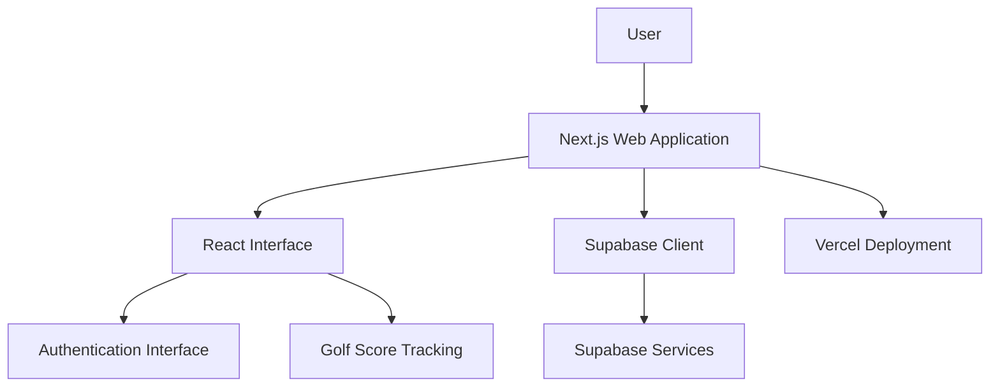

# ⛳ Golf Charity

### Golf Score Tracking Web Application

[](https://nextjs.org/)
[](https://react.dev/)
[](https://www.typescriptlang.org/)
[](https://supabase.com/)
[](https://golf-charity-ruby-xi.vercel.app/)

**[🌐 Live Application](https://golf-charity-ruby-xi.vercel.app/)** · **[💻 Source Code](https://github.com/AnanyaSingh2305/golf-charity)**

---

## 📖 Project Overview

Golf Charity is a web application built around golf score tracking and user account access.

The project uses Next.js and React to provide a modern web interface, TypeScript for structured application development, and Supabase as a backend service integration.

The application is deployed on Vercel and provides a publicly accessible login and signup interface.

---

## 📌 Navigation

[Overview](#-project-overview) ·
[Features](#-key-features) ·
[Architecture](#️-system-architecture) ·
[Tech Stack](#️-technology-stack) ·
[Installation](#-getting-started) ·
[Structure](#-repository-structure) ·
[Deployment](#-deployment)

---

## ✨ Key Features

### 1. User Authentication Interface

- Email and password input fields
- Login and signup options
- User-facing account access interface

### 2. Golf Score Tracking

- Golf score tracking is the application's stated purpose
- Designed as a web-based application for golf-related activity

### 3. Modern Web Development

- Built using Next.js and React
- Uses TypeScript for application development
- Styled using Tailwind CSS

### 4. Backend Integration

- Includes the Supabase JavaScript client
- Supports integration with Supabase services

### 5. Web Deployment

- Hosted on Vercel
- Accessible through a public application URL

---

## 🏗️ System Architecture



This is a high-level conceptual architecture based on the repository's dependencies and the application's visible purpose. It does not represent a verified internal data flow.

---

## 🛠️ Technology Stack

| Category | Technologies |
|---|---|
| Frontend | React 19, Next.js 16 |
| Programming Language | TypeScript |
| Styling | Tailwind CSS 4 |
| Backend Integration | Supabase JavaScript Client |
| Development Tools | ESLint, npm |
| Deployment | Vercel |

---

## 🚀 Getting Started

### Prerequisites

Before running the project, install:

- Node.js compatible with Next.js 16
- npm
- Git

### 1. Clone the Repository

```bash
git clone https://github.com/AnanyaSingh2305/golf-charity.git
cd golf-charity
```

### 2. Install Dependencies

```bash
npm install
```

### 3. Configure Environment Variables

If your Supabase integration requires environment variables, configure them in a local `.env.local` file.

Example:

```env
NEXT_PUBLIC_SUPABASE_URL=your_supabase_project_url
NEXT_PUBLIC_SUPABASE_ANON_KEY=your_supabase_publishable_or_anon_key
```

Check the application source for the exact variable names before using this example.

Never commit private credentials or service-role keys.

### 4. Start the Development Server

```bash
npm run dev
```

### 5. Open the Application

Visit:

http://localhost:3000

---

## 📁 Repository Structure

```text
golf-charity/
├── app/                  # Next.js application
├── lib/                  # Shared application utilities
├── public/               # Public static assets
├── .gitignore
├── AGENTS.md
├── CLAUDE.md
├── README.md
├── eslint.config.mjs
├── next.config.ts
├── package.json
├── package-lock.json
├── postcss.config.mjs
└── tsconfig.json
```

---

## 🔄 Application Workflow

1. The user opens the web application.
2. The application displays the login and signup interface.
3. The user can enter an email address and password.
4. The application is designed around golf score tracking.
5. Supabase is available as an integrated backend service.

The exact authentication persistence and score-management workflows should be verified against the application source.

---

## 🧪 Development and Validation

The repository provides the following npm commands:

| Command | Purpose |
|---|---|
| `npm run dev` | Start the development server |
| `npm run build` | Create a production build |
| `npm run start` | Start the production server |
| `npm run lint` | Run ESLint |

These commands are configured in `package.json`. Their successful execution has not been independently verified.

---

## 🌐 Deployment

The project has a public Vercel deployment.

**Live URL:**

https://golf-charity-ruby-xi.vercel.app/

### Deployment Platform

Vercel supports hosting Next.js applications with production builds and environment variable configuration.

Ensure that any required Supabase environment variables are configured in the deployment environment.

---

## 🔮 Future Improvements

Potential enhancements include:

- Detailed scorecards for individual players
- Tournament and event management
- Player leaderboards and performance history
- Administrative dashboards
- Charity event and fundraising management
- Responsive mobile score entry
- Automated testing and monitoring

These are proposed enhancements, not claims about currently implemented features.

---

## 👩‍💻 Author

**Ananya Singh**

Bachelor of Engineering — Information Science and Engineering

JSS Academy of Technical Education, Bengaluru

[GitHub](https://github.com/AnanyaSingh2305) ·
[LinkedIn](https://www.linkedin.com/in/ananya-singh-8934b4294/)

---


⭐ If you find this project interesting, consider starring the repository.
